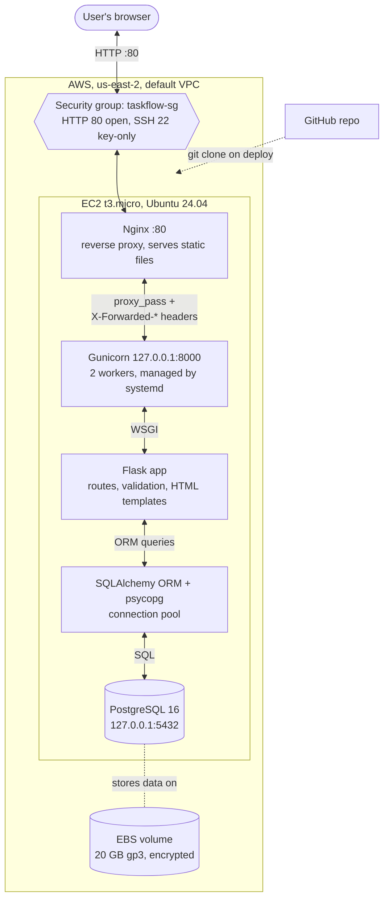
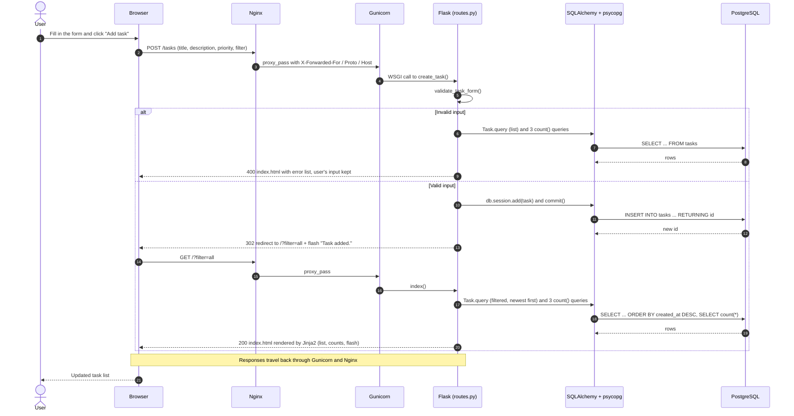

# TaskFlow

A small to-do list web app (create, edit, complete, filter and delete tasks) built
to demonstrate a production-style deployment on AWS: **Flask** behind **Gunicorn**
and **Nginx**, with data in **PostgreSQL**, running on a single **EC2** instance.

**Live:** http://77.113.88.146 &nbsp;·&nbsp; **Health:** http://77.113.88.146/health

## Architecture



Each arrow is two-way: the request travels down to the database, and the
response travels back up the same path to the browser. Only Nginx is
reachable from the internet. Gunicorn and PostgreSQL listen on localhost, so
the database is never exposed. Nginx serves CSS itself and passes everything
else to Gunicorn, which runs the Flask app.

### How a request travels: adding a task

Every change uses the **Post/Redirect/Get** pattern. The browser submits a
form, the app writes to the database and replies with a redirect, and the
browser then loads the updated list. Edit, complete and delete work the same
way.



When things go wrong, the user sees a friendly page rather than a stack trace:

| Situation                        | Response                                                     |
|----------------------------------|--------------------------------------------------------------|
| Invalid form input               | 400, form shown again with errors; nothing saved             |
| Task doesn't exist               | 404                                                          |
| Database unreachable             | 503, transaction rolled back, error logged                   |
| `/health` with database down     | 503 `{"status":"unhealthy","database":"down"}`               |

## Design decisions

- **One EC2 instance, PostgreSQL on the same host.** This is the simplest
  and cheapest setup that meets the requirements (free-tier eligible, three
  AWS resources in total). The trade-off is no managed backups and no
  failover. The app reads its database location from environment variables,
  so moving to RDS later means changing configuration, not code.
- **Minimal attack surface.** Only ports 80 and 22 are open. Gunicorn and
  PostgreSQL listen on localhost. The app runs as an unprivileged `taskflow`
  user. SSH accepts key-based logins only. PostgreSQL requires a password.
- **No secrets in git.** All configuration comes from environment
  variables. On the server, the deploy script generates the secret key and
  database password itself and stores them in a root-owned file
  (`/etc/taskflow/taskflow.env`).
- **Self-healing.** systemd starts Nginx, the app and PostgreSQL at boot and
  restarts the app if it crashes. The app checks each pooled connection
  before use, so it recovers from a database restart without being
  restarted itself. It also starts while the database is down and reports
  that through `/health`.
- **Observable.** `/health` checks both the app and database connectivity,
  ready for an uptime monitor or a load balancer health check. Application
  logs go to stdout and are collected by journald. Nginx keeps its own access
  log.
- **Persistent data.** PostgreSQL stores its data on the EBS volume, so tasks
  survive app restarts, database restarts and instance reboots. All three
  were tested.

## Running locally

Requires Python 3.9+ and PostgreSQL. On macOS:

```bash
brew install postgresql@16 && brew services start postgresql@16
export PATH="/opt/homebrew/opt/postgresql@16/bin:$PATH"
psql postgres -c "CREATE USER taskflow WITH PASSWORD 'change-me';"
psql postgres -c "CREATE DATABASE taskflow OWNER taskflow;"

python3 -m venv .venv && source .venv/bin/activate
pip install -r requirements.txt
cp .env.example .env            # set SECRET_KEY and DB_PASSWORD
python run.py                   # http://127.0.0.1:5000
```

The `tasks` table is created automatically on startup. To run it the way
production does, use `gunicorn --bind 127.0.0.1:8000 run:app`.

**Tests:** `pytest` runs 21 tests against an in-memory SQLite database, so
PostgreSQL isn't needed. They cover CRUD, validation, filters, error
handling, and the health check, including a simulated database outage.

## How it was deployed

1. **Provisioned the infrastructure** with the AWS CLI in `us-east-2`:

   | Resource       | Configuration                                                     |
   |----------------|-------------------------------------------------------------------|
   | EC2 instance   | t3.micro, Ubuntu 24.04, 20 GB encrypted gp3 EBS, IMDSv2 required |
   | Security group | `taskflow-sg`: HTTP 80 from anywhere, SSH 22 from anywhere        |
   | Key pair       | `taskflow-key`, used for SSH                                      |

   No RDS, load balancer or Elastic IP were needed.

2. **Configured the server** by running one idempotent script over SSH,
   [`deploy/setup_server.sh`](deploy/setup_server.sh). It installs
   PostgreSQL, Nginx and Python, clones this repository, generates the
   secrets, creates the database, and installs the
   [systemd service](deploy/taskflow.service) and
   [Nginx config](deploy/nginx-taskflow.conf). It finishes by checking
   `/health`.

3. **Verified it end to end** against the public URL. All CRUD actions
   worked. Stopping PostgreSQL made `/health` return 503, and it recovered
   to 200 without restarting the app. Tasks survived both an app restart
   and a full instance reboot.

**Redeploy** after pushing changes: SSH in and run the same script again. It
pulls the latest code and keeps the existing secrets and data.

```bash
ssh -i ~/.ssh/taskflow-key.pem ubuntu@77.113.88.146
curl -fsSL https://raw.githubusercontent.com/Jinal-Thummar/mangoapps/main/deploy/setup_server.sh -o setup_server.sh
REPO_URL=https://github.com/Jinal-Thummar/mangoapps.git bash setup_server.sh
```

**Useful commands on the server:** `sudo journalctl -u taskflow -f` (app
logs), `sudo systemctl status taskflow nginx postgresql` (service status),
`sudo systemctl restart taskflow` (restart the app).

<details>
<summary>AWS CLI commands used to provision the infrastructure</summary>

```bash
VPC=$(aws ec2 describe-vpcs --filters Name=is-default,Values=true --query 'Vpcs[0].VpcId' --output text)
AMI=$(aws ec2 describe-images --owners 099720109477 \
  --filters 'Name=name,Values=ubuntu/images/hvm-ssd-gp3/ubuntu-noble-24.04-amd64-server-*' \
  --query 'sort_by(Images,&CreationDate)[-1].ImageId' --output text)

aws ec2 create-key-pair --key-name taskflow-key --query KeyMaterial --output text > ~/.ssh/taskflow-key.pem
chmod 400 ~/.ssh/taskflow-key.pem

SG=$(aws ec2 create-security-group --group-name taskflow-sg \
  --description "TaskFlow web server" --vpc-id $VPC --query GroupId --output text)
aws ec2 authorize-security-group-ingress --group-id $SG --ip-permissions \
  "IpProtocol=tcp,FromPort=22,ToPort=22,IpRanges=[{CidrIp=0.0.0.0/0}]" \
  "IpProtocol=tcp,FromPort=80,ToPort=80,IpRanges=[{CidrIp=0.0.0.0/0}]"

aws ec2 run-instances --image-id $AMI --instance-type t3.micro --key-name taskflow-key \
  --security-group-ids $SG \
  --block-device-mappings '[{"DeviceName":"/dev/sda1","Ebs":{"VolumeSize":20,"VolumeType":"gp3","Encrypted":true}}]' \
  --metadata-options HttpTokens=required \
  --tag-specifications 'ResourceType=instance,Tags=[{Key=Name,Value=taskflow}]'
```

</details>

<details>
<summary>Tearing it down</summary>

Terminating the instance also deletes its EBS volume and all task data.

```bash
IID=$(aws ec2 describe-instances --filters Name=tag:Name,Values=taskflow \
  Name=instance-state-name,Values=running,stopped --query 'Reservations[].Instances[].InstanceId' --output text)
aws ec2 terminate-instances --instance-ids $IID
aws ec2 wait instance-terminated --instance-ids $IID
aws ec2 delete-security-group --group-name taskflow-sg
aws ec2 delete-key-pair --key-name taskflow-key
```

</details>

## Limitations and next steps

| Limitation                                    | Next step                                                   |
|-----------------------------------------------|-------------------------------------------------------------|
| HTTP only (no domain)                         | Add a domain and HTTPS via Let's Encrypt (`certbot --nginx`) |
| No database backups                           | Scheduled EBS snapshots, or move to RDS with automated backups |
| Single instance, no failover                  | Load balancer + Auto Scaling group + RDS                     |
| Public IP changes if the instance is stopped  | Elastic IP or a DNS record                                   |
| SSH open to all IPs (key-only)                | Restrict to admin IPs, or use SSM Session Manager            |
| No user accounts or CSRF protection           | Add authentication and Flask-WTF before real use             |

## Project layout

```
app/          Flask application: factory, model, routes, templates, CSS
tests/        pytest suite
deploy/       Server setup script, systemd unit, Nginx config
config.py     Settings, read from environment variables (see .env.example)
run.py        Entry point for `python run.py` and `gunicorn run:app`
```
