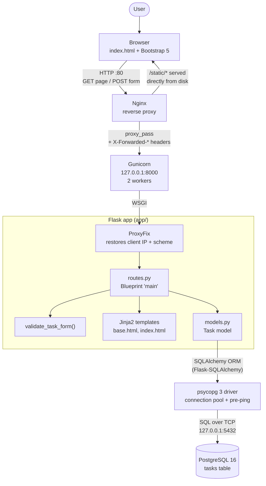
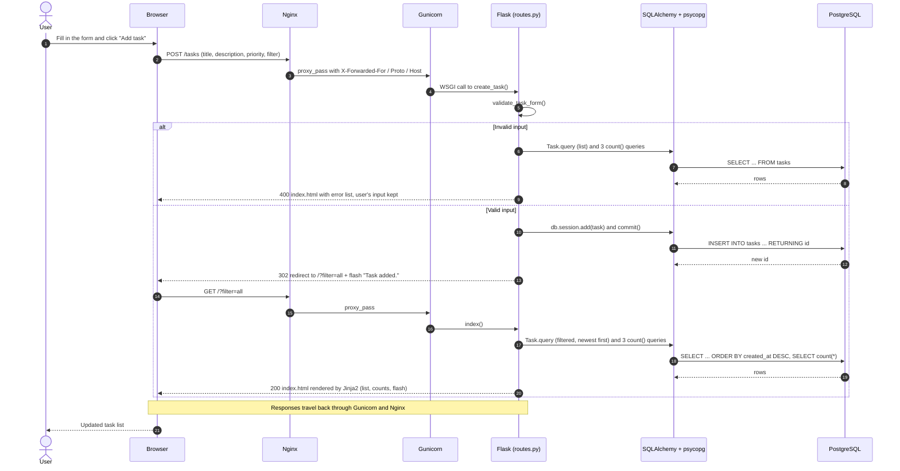

# TaskFlow

A simple, database-driven to-do list web application built with **Flask** and
**PostgreSQL**, prepared to run under **Gunicorn** behind an **Nginx** reverse proxy.

## Features

- Add, view, edit and delete tasks
- Mark tasks as completed / pending
- Priority: Low, Medium, High
- Filter: All, Pending, Completed
- Total / pending / completed counters
- Server-side input validation
- All data persisted in PostgreSQL
- `/health` endpoint that checks the app **and** database connectivity
- Structured logging to stdout, friendly error pages

## Project structure

```
app/
  __init__.py          Application factory (config, logging, DB, ProxyFix, error handlers)
  models.py            Task model (SQLAlchemy)
  routes.py            UI routes + /health
  templates/           base.html, index.html, error.html
  static/css/style.css
tests/test_app.py      pytest suite (in-memory SQLite, no PostgreSQL required)
config.py              Settings, all secrets read from environment variables
run.py                 Entry point (python run.py / gunicorn run:app)
requirements.txt
.env.example           Template for your local .env file
pytest.ini
deploy/
  setup_server.sh      One-command server setup / redeploy (Ubuntu 24.04)
  taskflow.service     systemd unit running Gunicorn
  nginx-taskflow.conf  Nginx reverse proxy config
```

## Architecture

### Components

How a request travels from the user's browser to PostgreSQL and back:



### CRUD request lifecycle

Every change uses the **Post/Redirect/Get** pattern: the browser POSTs a form,
the app writes to the database and answers with a redirect, and the browser
then GETs the refreshed list. Refreshing the page therefore never submits a
form twice. Example: adding a task.



Edit, toggle and delete follow the same POST, commit, 302, GET shape; only
the route and the SQL differ:

| Action           | Browser request            | Route function   | ORM operation                                         | SQL sent to PostgreSQL                         |
|------------------|----------------------------|------------------|-------------------------------------------------------|------------------------------------------------|
| View / filter    | `GET /?filter=pending`     | `index()`        | `Task.query.filter_by(completed=False)...all()` + counts | `SELECT ... WHERE completed = false ORDER BY created_at DESC` |
| Create           | `POST /tasks`              | `create_task()`  | `db.session.add(task)`, `commit()`                    | `INSERT INTO tasks ... RETURNING id`           |
| Open edit form   | `GET /tasks/<id>/edit`     | `edit_task()`    | `db.get_or_404(Task, id)`                             | `SELECT ... WHERE id = ?`                      |
| Update           | `POST /tasks/<id>/edit`    | `edit_task()`    | load task, set fields, `commit()`                     | `SELECT` by id, then `UPDATE tasks SET title, description, priority` |
| Complete/pending | `POST /tasks/<id>/toggle`  | `toggle_task()`  | load task, flip `completed`, `commit()`               | `SELECT` by id, then `UPDATE tasks SET completed` |
| Delete           | `POST /tasks/<id>/delete`  | `delete_task()`  | load task, `db.session.delete(task)`, `commit()`      | `SELECT` by id, then `DELETE FROM tasks WHERE id = ?` |

Error paths:

- **Invalid input** (empty or too-long title, unknown priority): HTTP 400; the
  form is shown again with the errors and nothing is written.
- **Unknown task id**: `db.get_or_404` returns HTTP 404 (`error.html`).
- **GET on a write route** (e.g. opening `/tasks/1/delete` in the address bar): HTTP 405.
- **Database unavailable or query failure**: the `SQLAlchemyError` handler
  rolls back the session, logs the error and returns HTTP 503 (`error.html`).
- **Delete** asks for confirmation in the browser (`confirm()`) before the form is submitted.

## Database schema

Table `tasks` (created automatically on startup):

| Column        | Type                      | Notes                                 |
|---------------|---------------------------|---------------------------------------|
| `id`          | integer, primary key      |                                       |
| `title`       | varchar(200), not null    |                                       |
| `description` | text, nullable            | max 1000 chars (validated)            |
| `priority`    | varchar(10), not null     | `Low` / `Medium` / `High` (CHECK)     |
| `completed`   | boolean, not null         | default `false`                       |
| `created_at`  | timestamptz, not null     | set automatically (UTC)               |

---

## Run locally (macOS)

### 1. Install and start PostgreSQL

```bash
brew install postgresql@16
brew services start postgresql@16          # starts now and on every login
echo 'export PATH="/opt/homebrew/opt/postgresql@16/bin:$PATH"' >> ~/.zshrc
source ~/.zshrc
```

### 2. Create the database and user

```bash
psql postgres -c "CREATE USER taskflow WITH PASSWORD 'choose-a-strong-password';"
psql postgres -c "CREATE DATABASE taskflow OWNER taskflow;"
```

### 3. Set up Python

```bash
cd /path/to/project
python3 -m venv .venv
source .venv/bin/activate
pip install -r requirements.txt
```

### 4. Configure environment variables

```bash
cp .env.example .env
python3 -c "import secrets; print(secrets.token_hex(32))"   # paste into SECRET_KEY
# edit .env: set SECRET_KEY and DB_PASSWORD
```

`.env` is git-ignored. In production, set the same variables through the
process manager (e.g. a systemd `EnvironmentFile`) instead of a `.env` file.

### 5. Run

Development server (auto-reload, debug):

```bash
python run.py
# open http://127.0.0.1:5000
```

With Gunicorn (how it runs in production):

```bash
gunicorn --bind 127.0.0.1:8000 --workers 3 --access-logfile - --error-logfile - run:app
# open http://127.0.0.1:8000
```

Tables are created automatically on startup. If PostgreSQL was down when the
app started, create them later with:

```bash
flask --app run init-db
```

---

## Testing

### Automated tests

```bash
source .venv/bin/activate
pytest -v
```

Tests use an in-memory SQLite database, so they run without PostgreSQL. They
cover CRUD, validation, filters, counters, 404/405 handling and the health
check (including a simulated database outage returning 503).

### Health check

```bash
curl -i http://127.0.0.1:5000/health
# HTTP/1.1 200 OK
# {"application":"up","database":"up","status":"healthy"}
```

Simulate a database outage:

```bash
# "fast" shutdown closes the app's open connections, like a real outage.
# (A plain `brew services stop` waits for clients to disconnect first.)
brew services stop postgresql@16
pg_ctl -D /opt/homebrew/var/postgresql@16 stop -m fast
curl -i http://127.0.0.1:5000/health     # HTTP/1.1 503 SERVICE UNAVAILABLE
brew services start postgresql@16
curl -i http://127.0.0.1:5000/health     # back to 200 (connections are re-checked automatically)
```

### Data persistence

1. Add a few tasks in the browser.
2. Stop the app (`Ctrl+C`) and start it again.
3. Reload the page: the tasks are still there, because they are stored in PostgreSQL.

You can also inspect the data directly:

```bash
psql -U taskflow -h localhost taskflow -c "SELECT id, title, priority, completed, created_at FROM tasks;"
```

---

## Environment variables

| Variable                | Required | Default      | Description                                  |
|-------------------------|----------|--------------|----------------------------------------------|
| `APP_ENV`               | no       | `production` | `development` or `production`                |
| `SECRET_KEY`            | yes*     | —            | Flask session signing key (*random in dev)   |
| `DATABASE_URL`          | no       | —            | Full Postgres URL; overrides the `DB_*` vars |
| `DB_HOST`               | no       | `localhost`  |                                              |
| `DB_PORT`               | no       | `5432`       |                                              |
| `DB_NAME`               | no       | `taskflow`   |                                              |
| `DB_USER`               | no       | `taskflow`   |                                              |
| `DB_PASSWORD`           | yes      | —            |                                              |
| `DB_CONNECT_TIMEOUT`    | no       | `5`          | Seconds before a DB connection attempt fails |
| `LOG_LEVEL`             | no       | `INFO`       |                                              |
| `SESSION_COOKIE_SECURE` | no       | `false`      | Set `true` when served over HTTPS            |

---

## AWS deployment (single EC2 instance)

### Architecture

```
Internet ──► Security group (80 open, 22 open: SSH key-only)
               │
               ▼
        EC2 t3.micro · Ubuntu 24.04
        ┌──────────────────────────────────────────┐
        │ Nginx :80  ──►  Gunicorn 127.0.0.1:8000   │
        │ (static files,     (systemd: taskflow,     │
        │  security headers)  2 workers, user        │
        │                     `taskflow`)            │
        │                        │                   │
        │                        ▼                   │
        │            PostgreSQL 16 127.0.0.1:5432    │
        │            (data on encrypted EBS volume)  │
        └──────────────────────────────────────────┘
```

AWS resources: **1 EC2 instance, 1 security group, 1 key pair.** No RDS,
load balancer or Elastic IP.

- Gunicorn and PostgreSQL listen on localhost only; Nginx is the only public
  service. The app uses Werkzeug's `ProxyFix` to trust Nginx's
  `X-Forwarded-*` headers (one proxy hop).
- Secrets (`SECRET_KEY`, DB password) are generated **on the server** by
  `setup_server.sh` and stored in `/etc/taskflow/taskflow.env`
  (`root:taskflow`, mode 640). They are never in git.
- PostgreSQL uses password (`scram-sha-256`) authentication.
- SSH (port 22) is open to any IP so the server can be managed from any
  network. sshd accepts **key-based logins only** (password and root password
  login are disabled in the Ubuntu AMI), so access requires
  `taskflow-key.pem`. Automated scanners will hit port 22 and fail; these
  attempts show up in `journalctl -u ssh`. For tighter security, restrict the
  rule to your own IP (`CidrIp=<your-ip>/32`).
- `postgresql`, `taskflow` and `nginx` are enabled systemd services, so
  everything starts automatically after a reboot; Gunicorn restarts on crash.
- Data lives on the instance's EBS volume and survives app restarts,
  database restarts and instance reboots.

### Create the infrastructure (AWS CLI)

```bash
REGION=us-east-2
VPC=$(aws ec2 describe-vpcs --filters Name=is-default,Values=true --query 'Vpcs[0].VpcId' --output text)
AMI=$(aws ec2 describe-images --owners 099720109477 \
  --filters 'Name=name,Values=ubuntu/images/hvm-ssd-gp3/ubuntu-noble-24.04-amd64-server-*' \
  --query 'sort_by(Images,&CreationDate)[-1].ImageId' --output text)

# Key pair (skip if you already have one)
aws ec2 create-key-pair --key-name taskflow-key --query KeyMaterial --output text > ~/.ssh/taskflow-key.pem
chmod 400 ~/.ssh/taskflow-key.pem

# Security group: SSH and HTTP from anywhere (SSH is key-only on the server)
SG=$(aws ec2 create-security-group --group-name taskflow-sg \
  --description "TaskFlow web server" --vpc-id $VPC --query GroupId --output text)
aws ec2 authorize-security-group-ingress --group-id $SG --ip-permissions \
  "IpProtocol=tcp,FromPort=22,ToPort=22,IpRanges=[{CidrIp=0.0.0.0/0}]" \
  "IpProtocol=tcp,FromPort=80,ToPort=80,IpRanges=[{CidrIp=0.0.0.0/0}]"

# EC2 instance (encrypted 20 GB gp3 disk, IMDSv2 required)
aws ec2 run-instances --image-id $AMI --instance-type t3.micro --key-name taskflow-key \
  --security-group-ids $SG \
  --block-device-mappings '[{"DeviceName":"/dev/sda1","Ebs":{"VolumeSize":20,"VolumeType":"gp3","Encrypted":true}}]' \
  --metadata-options HttpTokens=required \
  --tag-specifications 'ResourceType=instance,Tags=[{Key=Name,Value=taskflow}]'
```

### Deploy / redeploy

```bash
ssh -i ~/.ssh/taskflow-key.pem ubuntu@<EC2_PUBLIC_IP>
curl -fsSL https://raw.githubusercontent.com/Jinal-Thummar/mangoapps/main/deploy/setup_server.sh -o setup_server.sh
REPO_URL=https://github.com/Jinal-Thummar/mangoapps.git bash setup_server.sh
```

The script is idempotent: run it again after `git push` to deploy the latest
code. Existing secrets and data are kept.

### Operations

```bash
curl http://<EC2_PUBLIC_IP>/health                # 200 healthy / 503 database down
sudo systemctl status taskflow nginx postgresql    # service status
sudo journalctl -u taskflow -f                     # application + Gunicorn logs
sudo tail -f /var/log/nginx/access.log             # Nginx access log
sudo systemctl restart taskflow                    # restart the app
sudo -u postgres psql taskflow                     # database shell
```

### Tear down (stops all charges)

```bash
IID=$(aws ec2 describe-instances --filters Name=tag:Name,Values=taskflow \
  Name=instance-state-name,Values=running,stopped --query 'Reservations[].Instances[].InstanceId' --output text)
aws ec2 terminate-instances --instance-ids $IID
aws ec2 wait instance-terminated --instance-ids $IID
aws ec2 delete-security-group --group-name taskflow-sg
aws ec2 delete-key-pair --key-name taskflow-key
```

Note: without an Elastic IP, the public IP changes if the instance is
stopped and started (a reboot keeps it). There is no domain, so the site is
served over HTTP; with a domain, add HTTPS via Let's Encrypt (`certbot --nginx`)
and set `SESSION_COOKIE_SECURE=true`.

## Logging

Application logs go to **stdout** in the format
`timestamp [LEVEL] app: message`. Under Gunicorn, add `--access-logfile -`
and `--error-logfile -` so everything lands in one stream, which systemd and
journald collect automatically.

## Notes

- Normal database operations use the SQLAlchemy ORM. The only raw SQL is
  `SELECT 1` in the health check.
- No credentials are stored in the source code.
- The app has no authentication or CSRF protection (out of scope for this
  assessment). Add Flask-WTF/CSRF before exposing it publicly.
